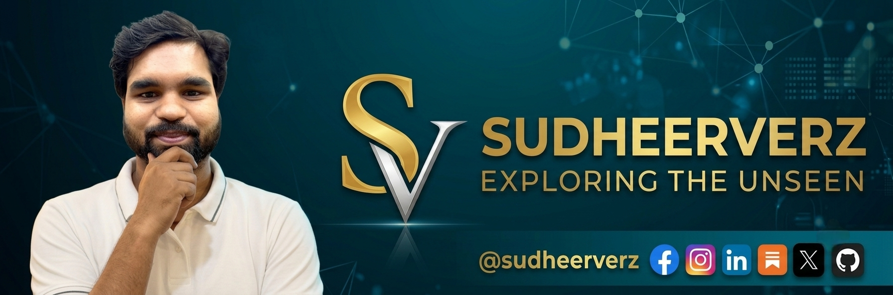

<!-- Image 1. Banner (UNCHANGED) -->

 
 

<!-- Real-time Terminal Typing Animation (Full Width - No Cutoff) -->

 

<!-- 3D Metallic Quick-Access Gateway Plates (Blue, Pink & Gray Theme) -->

  
  
  

<!-- 3D Fluid Blue, Pink & Gray Gradient Wave -->

<!-- ================= BLUE, PINK & GRAY GRADIENT ABOUT SECTIONS ================= -->

<table width="100%">
  <tr>
    <td width="100%" valign="top">
      
        
      <h4>🌌 Exploring the Unseen. Questioning What Everyone Accepts.</h4>
      
The world is full of questions we rarely ask, assumptions we rarely challenge, and architectures we have yet to architect.

      
<b>BINAYAKVERZ</b> is an independent research platform and intellectual publication dedicated to exploring advanced software systems, full-stack development, and structural ideas that shape our digital reality.

      
From scalable software engineering and web technologies to computer science and technical problem-solving, this is a space for rigorous analytical inquiry.

      
<i>We don’t just write code. We architect solutions, question assumptions, and investigate what lies beyond algorithms.</i>

       
      
    </td>
  </tr>
</table>

 

<table width="100%">
  <tr>
    <td width="100%" valign="top">
      
        
      
<b>Sudheer Kumar</b> is a Professional Software Full Stack Developer and Independent Researcher at <b>binayakverz</b>, specializing in robust application architectures, modern web ecosystems, and deep technical engineering.

      
His technical and analytical work is guided by three core principles:

      

        
        
        
      

      
The objective is not just to build software applications, but to investigate core engineering principles, optimize performance, and foster independent problem-solving.

       
      
    </td>
  </tr>
</table>

 

<!-- ================= CORE DOMAINS ================= -->

  

 

<!-- Row 1: Full Stack Engineering + System Architecture -->
<table width="100%">
  <tr>
    <td width="50%" valign="top">
      
      <h4>💻 Full Stack Software Development</h4>
      
Designing and building robust, scalable, and high-performance applications from front-end interfaces to back-end infrastructure, databases, and microservices with clean, maintainable code.

    </td>
    <td width="50%" valign="top">
      
      <h4>⚙️ System Architecture & Engineering</h4>
      
Exploring algorithmic efficiency, clean software patterns, database optimization, and scalable solutions that solve complex engineering challenges.

    </td>
  </tr>
  <tr>
    <td width="50%" valign="bottom">
      
    </td>
    <td width="50%" valign="bottom">
      
    </td>
  </tr>
</table>

 

<!-- Row 2: Independent Research + Problem Solving -->
<table width="100%">
  <tr>
    <td width="50%" valign="top">
      
      <h4>🔬 Independent Research at Binayakverz</h4>
      
Investigating computer science paradigms, technical architectures, and advanced programming concepts through independent research and documentation.

    </td>
    <td width="50%" valign="top">
      
      <h4>🚀 Technical Innovation & Code</h4>
      
Pushing the boundaries of what is possible with modern web development tools, frameworks, and continuous learning in software engineering.

    </td>
  </tr>
  <tr>
    <td width="50%" valign="bottom">
      
    </td>
    <td width="50%" valign="bottom">
      
    </td>
  </tr>
</table>

 

<!-- ================= TELEMETRY ================= -->

  

---

<!-- ================= 3D SINGLE-LINE RESPONSIVE SOCIAL DOCK ================= -->

<h3>⚡ Connect With Sudheer Kumar</h3>

Follow for full-stack architecture insights, code repositories, and updates across platforms (User ID: <b>@sudhirverz</b>)

  
  
  
  
  
  
  

<!-- 3D Sci-Fi Terminal Footer (Blue, Pink & Gray Wave Animation) -->

